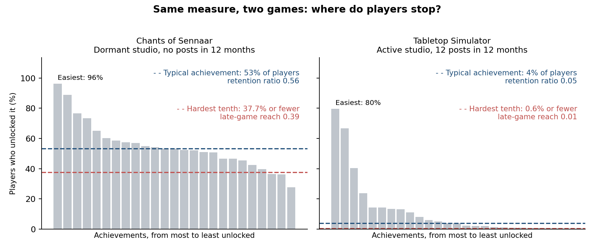
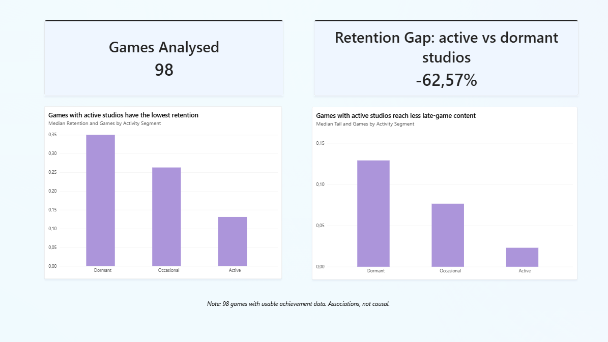
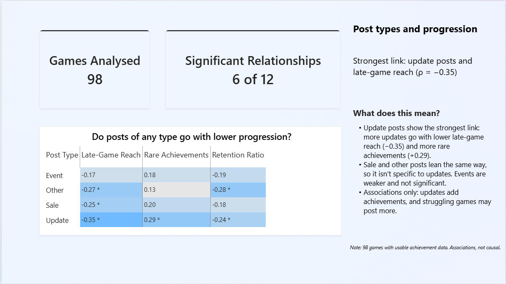
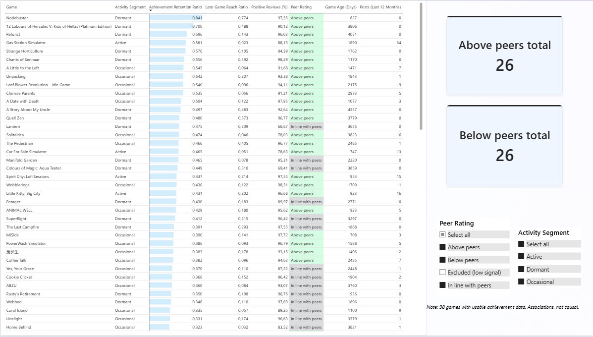

# Steam Game Health Scorecard
### _Do cosy indie games with active studios keep players engaged? A benchmark of progression and studio communication on Steam._

## Summary
This project benchmarks 103 established cosy indie games on Steam (98 with usable achievement data) on two dimensions: how far players progress, measured with global achievement unlock rates, and how studios communicate, measured with their news posts over the last 12 months. It identifies which titles show healthy content engagement and which show warning signs. 

**Key finding:** studios that post often are not associated with better progression. Games with active studios (12+ posts per year) have a median achievement retention ratio of 0.13, versus 0.26 for occasional and 0.35 for dormant studios, a gap of about 63% between active and dormant. The gap holds across game-age bands and after controlling for game age and owner count. Review scores do not differ between groups. The data, however, does not prove that posting reduces engagement: new content adds rarely unlocked achievements, and struggling games may attract more updates. Posting frequency should therefore not be used as a health signal on its own.

## Business Problem
A small indie publisher has limited budget for post-launch support. Which games are worth backing, and is a studio's communication activity a useful signal?  
In order to answer this, we ask two questions for each game:

* Progression: do players reach the late content, or do they drop off early?

* Communication: do studios that talk to players more or less often, or about different things, have players who go further?

**Stakeholder:** A hypothetical publisher or live-ops team. 

**Decision supported:** Which games to prioritize, fix, or deprioritize. More precisely, how to benchmark a game against comparable peers and where to spend support and marketing effort.



## Methodology


> **Sample description:**   
All candidate games come from the SteamSpy tag lists (Cozy, Wholesome, Relaxing, Farming Sim, Life Sim): 404 unique games. These were filtered to keep the games with the store genre Indie, released at least 12 months ago, and with at least 10 achievements: 103 games. 181 candidates were dropped as too recent, 103 as not Indie, 17 for too few achievements. Data was collected on 18 November 2026.

**Data collection (Python):** Achievement unlock percentages (GetGlobalAchievementPercentagesForApp) and news posts (GetNewsForApp) were retrieved from the Steam Web API; release dates, genres and achievement counts from the store Appdetails endpoint. The other endpoint, GetPlayerSummaries, was considered but not used as it returns player-level profiles, and the question is at game level.

**Data Cleaning (Python):** Removed duplicate news posts, converted UNIX timestamps, games with no "news" were counted as zero posts, and games with low-signal achievements were excluded from progression metrics.

**Database (SQLite + SQL):** CSVs are loaded into SQLite. Metrics are built as SQL views with window functions (medians, percentiles, gaps between posts) and cross-checked against a pandas version (all differences 0).

&ensp; **Progression metrics:** Median unlock rate relative to the most-unlocked achievement (retention ratio), 10th percentile relative to the same (late-game reach ratio), and the share of achievements unlocked by under 1% of players. Five games whose most common achievement is unlocked by under 5% of players were excluded from progression metrics.

&ensp; **Communication metrics:** Number of posts in the last 12 months, days since last post, and post length. Games were grouped in different categories: dormant (0 posts), occasional (under 1 per month) or active (1+ per month). Posts were classified using keyword rules on their titles as either updates, sales, events and others.

**Analysis (Python):** Kruskal-Wallis tests across segments, comparison inside age bands, and Spearman correlations controlling for game age and log owners.

**Visualization (Power BI):** Dashboard with three pages of visualizations: overview, post types, and a per-game scorecard rated against peers in the same activity segment.

## Skills

Python (requests, pandas, scipy), SQL (SQLite, window functions, views), API data collection, data cleaning and validation, rule-based text classification, nonparametric statistics, Power BI (DAX measures, conditional formatting), business storytelling.

## Results & Business Recommendation
### Results
- Median retention ratio: 0.35 (dormant, n=30), 0.26 (occasional, n=51), 0.13 (active, n=22); Kruskal-Wallis p ≤ 0.001. Review scores do not differ (p = 0.67).
- The pattern holds in all three age bands. Controlled correlation of posts per month: retention −0.30, late-game reach −0.42, share of rare achievements +0.29 (all p ≤ 0.005).
- Update posts show the strongest link (controlled late-game reach −0.35), but sale, event and other posts lean the same way, so it cannot be attributed to update posts alone. 6 of 12 post-type relationships are significant after controls.

### Recommendations
1. Do not treat posting frequency as a measure of game health. Active studios coincide with a lower share of players reaching late content, but this phenomenon can't be clearly attributed to posting.
2. Benchmark each game against peers in the same activity segment. AA retention ratio of 0.2 is above the median for an active title (0.13) but well below the median for a dormant one (0.35).
3. Hypothesis to test next: dormant games with high retention and high review scores may be the cheapest candidates for low-effort support such as seasonal sales and bundles.

### Limitations
- The sample is built from unofficial third-party tag lists, skewed toward recent releases, so it covers established games only.
- Achievement percentages are a snapshot with no dates, so updates adding achievements cannot be separated from real player behaviour.
- Post classification uses simple keyword rules; about one third of posts remain "other".
- Observational data from 98 games: associations, not causes. A robustness check on the 21 games matched by two or more tags kept the same ordering of segments (retention 0.35 / 0.34 / 0.24) but was too small to be significant (p = 0.38).
- 'Cosy' is defined loosely: a game qualifies with any one of five tags, and only 21 of the 98 analysed games matched two or more.

## Dashboard






 
The Power BI file is in `dashboard/`. It reads the CSVs in `data/powerbi/`, which use semicolons as separators and decimal commas (e.g. `0,841`) to match an Italian-locale system.

## Repository structure
```
GetCandidates.py            SteamSpy tag lists -> candidate games
FilterCandidates.py         store appdetails + inclusion filters -> sample
GetGameData.py              achievements and news via the Steam Web API
CleanAndMetrics.py          pandas metrics (kept as a cross-check)
BuildDB.py                  loads SQLite and builds metrics with sql/metrics.sql
Analysis.py                 segments, age bands, controlled correlations
PostTypes.py                keyword classification of news posts
Export.py                   dashboard-ready CSVs
Figures.py                  with no arguments, prints a table of games, with arguments 
                            draws the figure in the Business Problem section 
sql/                        metrics.sql, segments.sql, scorecard.sql
data/powerbi/               CSVs used by the dashboard
data/processed/             analysis outputs
data/interim/sample.csv     the 103-game sample
dashboard/                  Power BI file
images/                     dashboard screenshots and business problem example graph
```
 
## How to reproduce
1. `pip install -r requirements.txt`
2. Run the scripts in order, from the project root: `python GetCandidates.py` through `python Export.py`. Downloads are cached in `data/raw/`, so reruns are fast.
3. No API key is needed for the endpoints used.
4. SteamSpy tag lists and Steam news change over time, so a fresh run will give a slightly different sample. `data/interim/sample.csv` is the sample used for the published results.